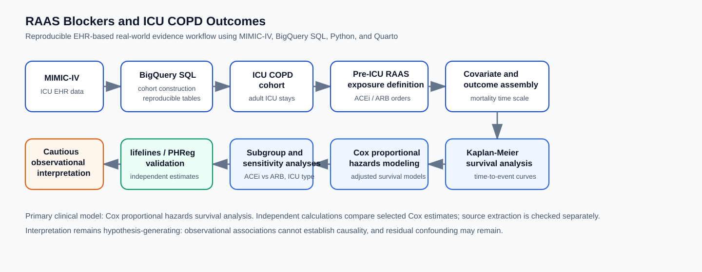
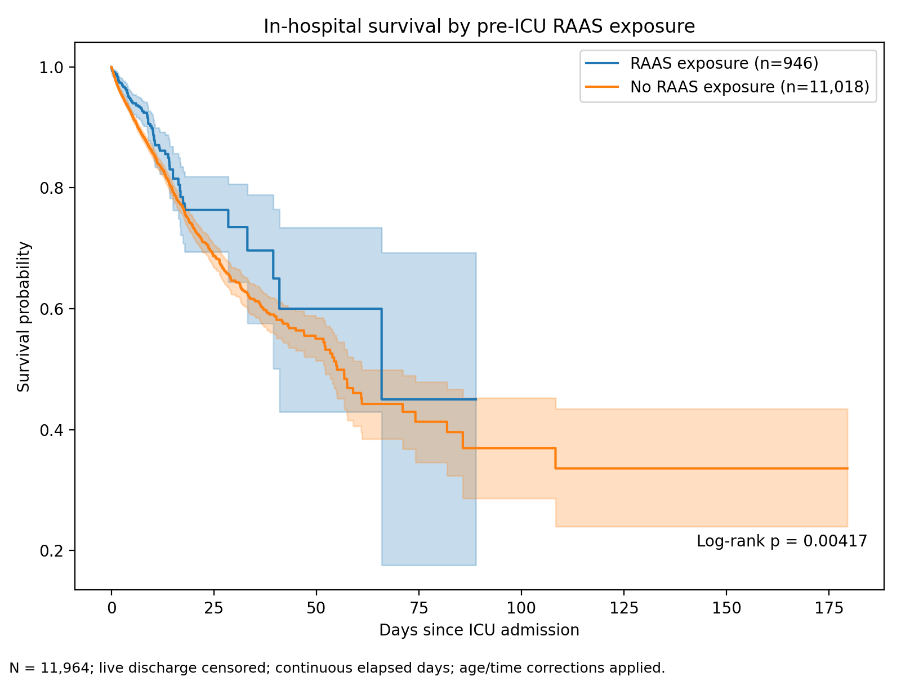
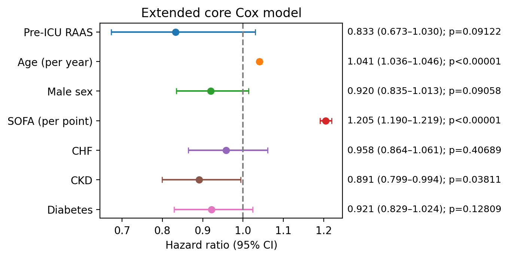

# RAAS Blockers and Clinical Outcomes in COPD ICU Admissions

*A reproducible MIMIC-IV clinical survival-analysis portfolio project*

Makoto Yoshida, PhD<br>
Clinical Data Analytics Portfolio<br>
LinkedIn: https://www.linkedin.com/in/makoto-yoshida/

## Executive Overview

This repository presents a retrospective observational cohort study using MIMIC-IV v3.1 to evaluate whether pre-ICU renin-angiotensin-aldosterone system (RAAS) inhibitor exposure is associated with time-to-in-hospital mortality among adult ICU patients with COPD.

The project is designed as a clinical analytics portfolio example: BigQuery SQL defines the ICU COPD cohort, exposure, covariates, and outcome; Python/Jupyter notebooks perform Kaplan-Meier survival analysis and Cox proportional hazards modeling; statsmodels PHReg independently checks selected lifelines Cox estimates; and Quarto packages the analysis into a narrative clinical report.

The findings are observational and hypothesis-generating. They should not be interpreted as evidence that RAAS inhibitors cause lower mortality.

## 2026-11-18 Analysis Correction

Admission-age and continuous follow-up definitions have been corrected, all eight ICU-COPD BigQuery analysis tables regenerated, and 04a/b/c models re-estimated. Current results, the separated age/time comparison, PH diagnostics, and table QA are in [the correction validation report](docs/AGE_TIME_REVALIDATION.md).

The local figures and Quarto report have been refreshed from the corrected tables. Notebooks share the same model/figure functions and retain stripped outputs. Six unpenalized Cox specifications (40 coefficients) were independently recalculated with statsmodels PHReg and matched the lifelines reference within an absolute tolerance of 1e-4. See [the independent calculation record](docs/INDEPENDENT_REVALIDATION.md) and [the reproducible scope](docs/REPRODUCIBLE_SCOPE.md).

## Full Analysis Report

- [Quarto clinical analysis report](https://makotoy56.github.io/mimic-iv-copd-raas-analysis/copd_raas_survival_report.html)

The Quarto report provides the single narrative version of the study question, methods, results, figures, interpretation, limitations, and reproducibility notes. The README is a portfolio-oriented landing page for reviewers who want to understand the project quickly.

## Study Snapshot

| Area | Summary |
| --- | --- |
| Data source | MIMIC-IV v3.1 |
| Design | Retrospective observational ICU cohort |
| Population | Adult ICU patients with COPD |
| Analytic unit | One qualifying hospital admission per record, anchored to the first ICU stay in that admission |
| Exposure | Pre-ICU inpatient ACE inhibitor or ARB prescription orders before or at ICU admission |
| Outcome | In-hospital death: ICU admission to recorded death time, with discharge-time fallback if death time is unavailable; live discharge: ICU admission to discharge, censored at discharge |
| Primary analysis | Kaplan-Meier survival curves and Cox proportional hazards modeling |
| Subclass analysis | ACEi-only and ARB-only prescription-order groups, each versus neither; no direct between-class test |
| Sensitivity analysis | Exploratory first-day-SOFA, comorbidity and ICU-type specifications; not baseline-only severity adjustment |
| Validation | Source-SQL and table QA; independent lifelines–PHReg comparison of six unpenalized Cox specifications |

Exposure flags identify inpatient prescription records in the same hospital admission with `starttime <= intime`. They do not verify actual administration, continued treatment at ICU entry, adherence or concurrent ACEi/ARB administration. Both positive class flags mean qualifying records for both classes; they do not establish simultaneous treatment. Neither means no qualifying prescription record for either class, not proven absence of all medication use. Outpatient chronic use, dose, duration, indication and discontinuation before hospitalization are not directly measured.

## What This Demonstrates

- Real-world evidence workflow using ICU electronic health record data
- Reproducible cohort, exposure, covariate, and outcome construction in BigQuery SQL
- Time-to-event analysis using Kaplan-Meier curves and Cox proportional hazards regression
- Proportional hazards diagnostics and refined survival-model specification
- ACEi-only and ARB-only prescription-order associations against a shared neither-order reference
- Exploratory sensitivity modeling using first-day severity, comorbidity, and ICU case mix, with explicit timing limitations
- Independent Cox calculations using lifelines and statsmodels PHReg, with recorded cohort and query provenance
- Clinical reporting with transparent limitations and residual-confounding discussion

## Key Findings

- Pre-ICU RAAS inhibitor exposure was associated with lower observed in-hospital mortality in Kaplan-Meier and Cox survival analyses.
- The refined era-stratified Cox model estimated HR 0.732 (95% CI 0.592-0.904; p = 0.00383) for any qualifying pre-ICU ACEi/ARB prescription order.
- Against neither qualifying prescription order, ACEi-only orders had HR 0.683 (95% CI 0.521-0.894; p = 0.00550) and ARB-only orders had HR 0.805 (95% CI 0.573-1.131; p = 0.21116). The main results report no direct ACEi-versus-ARB test; the differing significance levels do not establish a between-class difference.
- The exploratory extended core specification had HR 0.833 (95% CI 0.673-1.030; p = 0.09122). SOFA-containing core and ICU specifications can include information through 24 hours after follow-up starts. Their attenuation cannot be attributed solely to controlling pre-ICU confounding.

See [Results summary](docs/RESULTS_SUMMARY.md) and [Discussion and limitations](docs/DISCUSSION_AND_LIMITATIONS.md) for interpretation details.

## Workflow Overview



The workflow moves from MIMIC-IV ICU tables to cohort construction, RAAS exposure definition, mortality outcome construction, baseline characterization, Kaplan-Meier and Cox survival analysis, sensitivity modeling, independent Cox calculations, and Quarto reporting.

For source tables, outcome-table outputs and model dependencies, see [the outcome-table dependency map](docs/METHODS_OVERVIEW.md#outcome-table-dependencies).

For clinical analytics, RWE, HEOR, and outcomes research teams, the portfolio value is the reproducible workflow: defensible cohort definitions, documented modeling decisions, explicit sensitivity analysis, and validation checks that make results easier to review.

## Representative Figures

Figures shown in the README are generated from the analysis notebooks and saved under [assets/](assets/) so that rerunning the notebooks refreshes the displayed results.

### Kaplan-Meier Survival Curve



This unadjusted survival curve compares observed in-hospital survival patterns between ICU COPD patients with and without pre-ICU RAAS inhibitor exposure.

### Exploratory Extended Core Cox Model Forest Plot



This forest plot is generated by the 04c notebook and summarizes the exploratory unpenalized core model adjusted for age, sex, first-day SOFA, congestive heart failure, chronic kidney disease, and diabetes. First-day SOFA can use information through 24 hours after ICU entry; this is not baseline-only severity adjustment. It does not depict the refined primary 04a Cox model. The current corrected estimate is HR 0.833 (95% CI 0.673-1.030; p = 0.09122). All estimates should be interpreted as observational associations, not causal treatment effects.

Additional portfolio figures include the RAAS subgroup forest plot and the extended covariate sensitivity comparison in [assets/](assets/).

## Technical Snapshot

| Area | Details |
| --- | --- |
| Data platform | MIMIC-IV v3.1 through PhysioNet and BigQuery |
| Cohort construction | Version-controlled BigQuery SQL |
| Analysis environment | Python, pandas, lifelines, statsmodels, Jupyter |
| Survival methods | Kaplan-Meier curves, log-rank comparison, Cox proportional hazards models |
| Model diagnostics | Schoenfeld residual-based proportional hazards checks |
| Sensitivity models | Exploratory first-day-SOFA, ICU-type, penalized and CHF/SOFA-stratified Cox specifications |
| Independent model implementation | statsmodels PHReg compared with lifelines, using Efron ties and matched strata |
| Reporting | Quarto HTML report and modular documentation |

## Reproducibility And Data Governance

The workflow uses version-controlled notebooks, SQL scripts, Python analysis and validation scripts, modular documentation, and a Quarto report. No patient-level data are included in this repository.

For complete environment and reproducibility details, see [REPRODUCIBILITY.md](REPRODUCIBILITY.md).

Data-governance practices:

- No raw MIMIC-IV tables are tracked in Git.
- No derived patient-level cohort exports are tracked in Git.
- Local MIMIC-derived data and generated model-input files are ignored; only aggregate results are published.
- The repository contains code, documentation, curated figures, and rendered portfolio materials only.
- Full data extraction and analysis require independent PhysioNet/MIMIC approval, Google Cloud authentication, and BigQuery access. Rebuilding the report from the saved aggregate results requires no clinical data transfer.

Python environment:

```text
uv sync --locked
```

Validation scope:

- [Source-SQL validation](scripts/revalidate_age_time.py) reconstructs the cohort from source-table SELECTs and evaluates age/time definitions and outcome QA.
- [Independent Cox calculation](scripts/independent_cox_crosscheck.py) reads the current versioned model inputs and independently fits six unpenalized Cox specifications. The [record](docs/INDEPENDENT_COX_CROSSCHECK.json) includes cohort aggregates, query/reference hashes, estimates, and comparison tolerances.
- This separate implementation uses the same corrected inputs; it does not establish causality, validate penalized fits or PH tests, or independently re-extract source records.
- [The table checklist](scripts/validation_checklist.py) checks existence only; content QA is recorded separately.

## Explore The Project

Notebook workflow:

- [01 ICU cohort extraction](notebooks/01_icu_cohort.ipynb) and [short notes](docs/01_icu_cohort_SHORT.md)
- [02 COPD cohort and RAAS exposure](notebooks/02_cohort_and_exposures.ipynb) and [short notes](docs/02_cohort_and_exposures_SHORT.md)
- [03 baseline covariates](notebooks/03a_baseline.ipynb) and [short notes](docs/03a_baseline_SHORT.md)
- [03 exposure merge](notebooks/03b_merge_exposures.ipynb) and [short notes](docs/03b_merge_exposures_SHORT.md)
- [04a primary survival analysis](notebooks/04a_outcomes_and_modeling.ipynb) and [short notes](docs/04a_outcomes_and_modeling_SHORT.md)
- [04b ACEi-only and ARB-only orders versus neither](notebooks/04b_outcomes_and_modeling_raas_subgroups.ipynb) and [short notes](docs/04b_outcomes_and_modeling_raas_subgroups_SHORT.md)
- [04c extended covariate Cox models](notebooks/04c_extended_covariate_cox_model.ipynb) and [short notes](docs/04c_extended_covariate_cox_model_SHORT.md)
- [04d secondary Python logistic validation model](notebooks/04d_python_logistic_model.ipynb) and [short notes](docs/04d_python_logistic_model_SHORT.md)

Supporting documentation:

- [Study background](docs/STUDY_BACKGROUND.md): RAAS biology, COPD rationale, and prior literature
- [Methods overview](docs/METHODS_OVERVIEW.md): design, cohort, exposure, outcome, covariates, and analysis plan
- [Results summary](docs/RESULTS_SUMMARY.md): concise findings without causal strengthening
- [Discussion and limitations](docs/DISCUSSION_AND_LIMITATIONS.md): interpretation, residual confounding, and generalizability
- [Validation notes](docs/VALIDATION_NOTES.md): source, model and report reproducibility checks
- [Figure reproducibility](docs/FIGURE_REPRODUCIBILITY.md): README figure export locations and refresh workflow
- [PACE](docs/PACE.md): project planning and execution context
- [Quarto report source](reports/copd_raas_survival_report.qmd)

## Limitations And Observational Scope

This analysis is a retrospective observational study. It cannot establish that RAAS inhibitor exposure caused lower mortality.

Key limitations:

- Residual confounding and confounding by indication may remain despite covariate adjustment.
- Inpatient prescription orders do not directly measure outpatient chronic medication use, adherence, dose, duration, or indication.
- COPD status is identified using diagnosis codes recorded during hospitalization.
- MIMIC-IV reflects ICU admissions from a specific health system and may not generalize to other settings.
- Live discharge is treated as censoring in the primary Cox analysis; a competing-risk framework was not implemented.
- Each record represents a qualifying hospital admission anchored to its first ICU stay. Patients may contribute more than one admission, and the Cox models do not include a patient-level clustering or frailty term.
- Each subclass is compared with neither qualifying prescription order; no direct ACEi-versus-ARB contrast supports a superiority claim.
- `sofa_score` comes from `mimiciv_3_1_derived.first_day_sofa`. Its published definition can use information through 24 hours after ICU entry, while follow-up starts at ICU entry. All SOFA-containing core, ICU-adjusted and CHF/SOFA-stratified models are therefore exploratory sensitivity analyses that can use post-start information, not baseline-only severity adjustment. Temporal leakage or adjustment for post-exposure information may affect interpretation; its impact has not been quantified here. The primary age/sex model with era strata is unchanged. Time-aligned severity adjustment or a separate landmark design would require reanalysis.
- Differences across the exploratory SOFA/ICU specifications cannot be interpreted solely as correction of baseline confounding. See [timing limitations and separate reanalysis options](docs/ANALYSIS_TIMING_LIMITATIONS.md).

## Project Structure

```text
mimic-iv-copd-raas-analysis/
|-- assets/           # Portfolio visuals generated from notebooks
|-- docs/             # Study background, methods, results, limitations, validation notes, and Pages HTML
|-- notebooks/        # 01-04d executable Python analysis notebooks
|-- reports/          # Quarto report source and render configuration
|-- scripts/          # Validation utilities
|-- sql/              # BigQuery SQL for cohort, exposure, baseline, and outcome construction
`-- README.md
```

## Data Source And Compliance

This project uses MIMIC-IV v3.1, maintained by the MIT Laboratory for Computational Physiology and made available via PhysioNet.

Johnson A., Bulgarelli L., Pollard T., Gow B., Moody B., Horng S., Celi L.A., & Mark R. (2024). *MIMIC-IV (version 3.1)*. PhysioNet. RRID:SCR_007345. https://doi.org/10.13026/kpb9-mt58.

Access was granted after required training and approval under the PhysioNet data use agreement. This repository contains no patient-level data.
