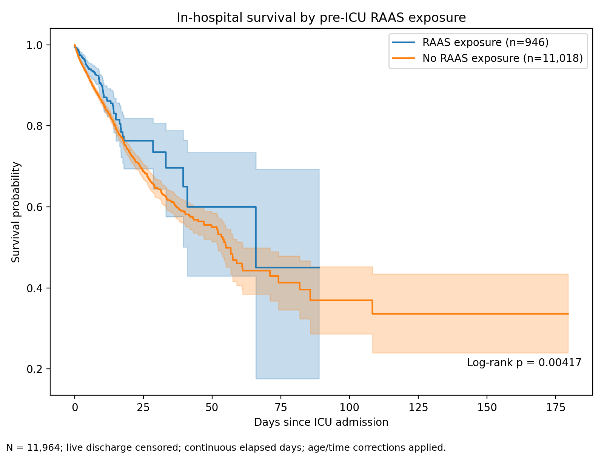

<!-- Generated by scripts/render_short_notes.py; edit its templates rather than this file. -->

# 04a — Primary ICU-COPD survival analysis (SHORT)

[Full notebook](../notebooks/04a_outcomes_and_modeling.ipynb)

## Objective

Assess qualifying pre-ICU RAAS prescription orders and in-hospital mortality from ICU entry.

## Input

- `mimic-iv-portfolio.copd_raas.cohort_copd_outcomes_extended`
- `mimic-iv-portfolio.copd_raas.cohort_copd_raas_detailed` (joined by the shared loader)

## Output and downstream use

- No new persistent BigQuery table.
- Shared `refresh()` recomputes all main model specifications, four figures, `docs/CURRENT_ANALYSIS.json`, and the optional secondary logistic exports under ignored `python/outputs/`.
- Report source and narrative are regenerated when their provenance checks pass. Revalidate/rebind supplementary results after changing the main reference; build final HTML with `scripts/build_report.py`.

## Key methods and scope

- Run `sql/04_build_outcomes.sql` and then `sql/04_build_outcomes_extended.sql` after phase 03 and before any 04-series notebook. Those SQL scripts create the outcome tables; the 04-series notebooks do not. See [the dependency map](METHODS_OVERVIEW.md#outcome-table-dependencies).
- Calls shared `refresh()` and displays refined primary estimates and rank PH p-values. It reads prebuilt outcome tables; it does not build outcomes in BigQuery.
- Uses continuous elapsed follow-up to recorded in-hospital death; discharge time is a flagged fallback only when death time is missing. Live discharge is censored in this cause-specific analysis.
- The refined primary Cox model adjusts for age and sex, stratifies by `anchor_year_group`, and uses ordinary model-based intervals without SOFA or patient clustering.
- Shared calculations also fit Kaplan-Meier/log-rank and rank Schoenfeld-based PH diagnostics. Four main figures are refreshed together.

## Results summary

The saved main cohort has 11,964 admissions and 1,692 deaths. The refined primary estimate is HR 0.732 (95% CI 0.592–0.904); p=0.00383. These are observational associations. Numerical source: [CURRENT_ANALYSIS.json](CURRENT_ANALYSIS.json).

### Figure 1 — Kaplan–Meier estimates

**How to read**

- The horizontal axis is elapsed days since ICU entry; the vertical axis is the unadjusted Kaplan–Meier survival estimate. Blue represents qualifying pre-ICU RAAS orders and orange represents no qualifying orders. Shading shows pointwise 95% confidence intervals.
- Live discharge is censored. Consequently, one minus this curve is not the observed cumulative probability of hospital death when discharge is a competing event; use the separate CIF figure for that question.

**What the results show**

- The overall two-group log-rank p-value is 0.00417. It compares the unadjusted survival experience over follow-up, rather than testing every plotted day or controlling for age, severity and other confounding.

**Interpretation limits**

- Wider intervals in the late tail indicate less precise estimates. Visual separation is an observational association and does not establish a medication benefit. The curve is not an adjusted Cox prediction.

## Related analyses

[05a](05a_patient_cluster_sensitivity_SHORT.md) separately evaluates patient-cluster inference; [05b](05b_competing_risks_SHORT.md) reports death/discharge cumulative incidence. These preserve the original main estimates.

## Next step

Next: [04b — Subclasses versus neither](04b_outcomes_and_modeling_raas_subgroups_SHORT.md).
