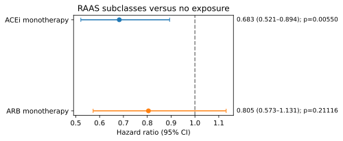

<!-- Generated by scripts/render_short_notes.py; edit its templates rather than this file. -->

# 04b — ACEi-only and ARB-only orders versus neither (SHORT)

[Full notebook](../notebooks/04b_outcomes_and_modeling_raas_subgroups.ipynb)

## Objective

Estimate each prescription-order class association against the shared neither-order reference.

## Input

- `mimic-iv-portfolio.copd_raas.cohort_copd_outcomes_extended`
- `mimic-iv-portfolio.copd_raas.cohort_copd_raas_detailed` (joined by the shared loader)

## Output and downstream use

- No new persistent BigQuery table.
- Shared `refresh()` recomputes all main model specifications, four figures, `docs/CURRENT_ANALYSIS.json`, and the optional secondary logistic exports under ignored `python/outputs/`.
- Report source and narrative are regenerated when their provenance checks pass. Revalidate/rebind supplementary results after changing the main reference; build final HTML with `scripts/build_report.py`.

## Key methods and scope

- Run `sql/04_build_outcomes.sql` and then `sql/04_build_outcomes_extended.sql` after phase 03 and before any 04-series notebook. Those SQL scripts create the outcome tables; the 04-series notebooks do not. See [the dependency map](METHODS_OVERVIEW.md#outcome-table-dependencies).
- Calls shared `refresh()` and displays subgroup estimates and PH p-values; it is not an isolated subgroup-only refresh.
- Excludes records with both class flags positive. Fits ACEi and ARB indicators together with age and sex, stratified by era, using ordinary model-based inference.
- Each class is compared with neither qualifying order. The main results contain no direct ACEi-versus-ARB test; differing p-values do not establish a class difference.
- Uses the original ICU-entry endpoint/fallback definition and live-discharge censoring. Order flags do not establish actual or simultaneous administration.

## Results summary

The saved subclass model includes 11,951 admissions and 1,690 deaths. ACEi-only versus neither: HR 0.683 (95% CI 0.521–0.894); p=0.00550. ARB-only versus neither: HR 0.805 (95% CI 0.573–1.131); p=0.21116. Source: [CURRENT_ANALYSIS.json](CURRENT_ANALYSIS.json).

### Figure 1 — ACEi-only and ARB-only order estimates versus neither

**Data source:** Saved clinical execution results; [aggregate record](CURRENT_ANALYSIS.json).

**How to read**

- Both rows use neither qualifying order as the reference. The blue dot is ACEi-only and the orange dot is ARB-only. Each is an age/sex-adjusted, era-stratified HR with an ordinary admission-level 95% interval on a linear scale. HR=1 is the reference line; records with both class flags positive are excluded.

**What the results show**

- ACEi-only orders: 0.683 (95% CI 0.521–0.894); ARB-only orders: 0.805 (95% CI 0.573–1.131). The ACEi interval lies below 1, whereas the ARB interval includes 1.

**Interpretation limits**

- Different point estimates or p-value thresholds do not establish a difference between classes. This plot contains no direct ACEi-versus-ARB contrast and does not establish superiority or equivalence.
- The flags describe prescription orders, not verified administration or adherence. These associations do not estimate causal drug effects.

## Related analyses

The published [05a–05c supplements](SURVIVAL_SENSITIVITY_SUPPLEMENTS.md) use the binary RAAS grouping, not new class-specific or direct ACEi/ARB analyses. The separate [local contrast workflow](ACEI_ARB_SUPPLEMENT_LOCAL.md) remains outside the public main results.

## Next step

Next: [04c — Exploratory extended models](04c_extended_covariate_cox_model_SHORT.md).
