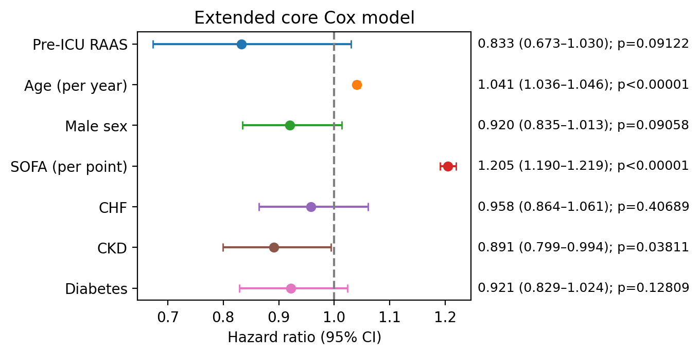
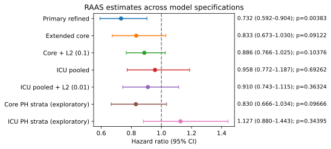

<!-- Generated by scripts/render_short_notes.py; edit its templates rather than this file. -->

# 04c — Exploratory extended Cox models (SHORT)

[Full notebook](../notebooks/04c_extended_covariate_cox_model.ipynb)

## Objective

`sofa_score` comes from `mimiciv_3_1_derived.first_day_sofa`. Its published definition can use information through 24 hours after ICU entry, while follow-up starts at ICU entry. All SOFA-containing core, ICU-adjusted and CHF/SOFA-stratified models in the original ICU-entry workflow are therefore exploratory sensitivity analyses that can use post-start information, not baseline-only severity adjustment. Temporal leakage or adjustment for post-exposure information may affect interpretation; its impact has not been quantified here. The primary age/sex model with era strata is unchanged. A separate exploratory 24-hour landmark analysis is reported in the supplementary results; pre-ICU severity reconstruction remains unperformed.

## Input

- `mimic-iv-portfolio.copd_raas.cohort_copd_outcomes_extended`
- `mimic-iv-portfolio.copd_raas.cohort_copd_raas_detailed` (joined by the shared loader)

## Output and downstream use

- No new persistent BigQuery table.
- Shared `refresh()` recomputes all main model specifications, four figures, `docs/CURRENT_ANALYSIS.json`, and the optional secondary logistic exports under ignored `python/outputs/`.
- Report source and narrative are regenerated when their provenance checks pass. Revalidate/rebind supplementary results after changing the main reference; build final HTML with `scripts/build_report.py`.

## Key methods and scope

- Run `sql/04_build_outcomes.sql` and then `sql/04_build_outcomes_extended.sql` after phase 03 and before any 04-series notebook. Those SQL scripts create the outcome tables; the 04-series notebooks do not. See [the dependency map](METHODS_OVERVIEW.md#outcome-table-dependencies).
- Calls shared `refresh()`; SOFA, comorbidity flags and ICU type are already joined by the extended-outcome SQL.
- Core adds first-day SOFA, CHF, CKD and diabetes to age/sex/RAAS with era strata. Class-specific ACEi/ARB indicators are not included.
- Pools ICU labels with fewer than 50 admissions using frequency alone. Evaluates unpenalized and L2-penalized core/ICU fits.
- Additional exploratory fits stratify by era, CHF and exact SOFA; the ICU version also stratifies by pooled ICU type. Rank PH tests and warnings require model-specific interpretation.
- These ICU-entry main sensitivity fits retain ordinary admission-level intervals and live-discharge censoring.

## Results summary

| Specification | RAAS HR (95% CI) | p |
| --- | --- | ---: |
| Unpenalized core | 0.833 (0.673–1.030) | 0.09122 |
| Core + L2 (0.1) | 0.886 (0.766–1.025) | 0.10376 |
| Pooled ICU | 0.958 (0.772–1.187) | 0.69262 |
| Pooled ICU + L2 (0.01) | 0.910 (0.743–1.115) | 0.36324 |
| CHF/SOFA strata | 0.830 (0.666–1.034) | 0.09666 |
| CHF/SOFA/ICU strata | 1.127 (0.880–1.443) | 0.34395 |

All rows are exploratory ICU-entry specifications. Their differences do not isolate pre-ICU confounding. Source: [CURRENT_ANALYSIS.json](CURRENT_ANALYSIS.json).

### Figure 1 — Exploratory SOFA-core Cox estimates

**How to read**

- Each dot is an adjusted hazard ratio; its horizontal bar is an ordinary admission-level 95% confidence interval. Colors distinguish covariate rows, not statistical significance. The dashed line at HR=1 represents equal hazards under the fitted model. The horizontal scale is linear.
- Read the unit of each row: age is per year, SOFA is per point, male sex is relative to female sex, and the binary RAAS/CHF/CKD/diabetes rows compare flag 1 with flag 0. Different units mean that distance from 1 cannot be used to rank clinical importance across rows.

**What the results show**

- The RAAS row is HR 0.833 (95% CI 0.673–1.030) in the era-stratified, unpenalized SOFA-core model. The interval includes 1; this does not establish equivalence or absence of an association.

**Interpretation limits**

- This is the exploratory 04c model, not the refined primary 04a model or the separate patient-cluster analysis. First-day SOFA may include post-start information. The estimates are conditional associations and cannot establish treatment effects.

### Figure 2 — Model sensitivity comparison

**How to read**

- Every row estimates the same qualifying-RAAS-orders versus no-qualifying-orders contrast under a different Cox specification. Dots are HRs and horizontal bars are that specification's original 95% intervals on a linear scale. Colors separate model rows for readability; these are not different medication groups.

**What the results show**

- The primary estimate is 0.732 (95% CI 0.592–0.904); the exploratory SOFA-core estimate is 0.833 (95% CI 0.673–1.030). These plotted intervals use the original inference, not the later patient-cluster intervals or 24-hour landmark population. Interpret every row using its own confidence interval.

**Interpretation limits**

- L2 rows use penalization; the ICU and PH-stratified rows change covariates or baseline-hazard strata. Their differences cannot isolate a single confounder, and one interval crossing 1 while another does not is not a test of the difference between estimates.
- SOFA-containing rows are exploratory and can use post-start information. The set of models is a sensitivity analysis of an observational association, not independent replications of a causal treatment effect.

## Related analyses

[05a](05a_patient_cluster_sensitivity_SHORT.md) separately reports cluster intervals for the core model. [05c](05c_time_aligned_severity_SHORT.md) implements the distinct 24-hour landmark; it does not reconstruct pre-ICU severity or independently verify component times.

## Next step

Optional: [04d — Secondary logistic export](04d_python_logistic_model_SHORT.md). The 05-series supplements do not depend on running 04d.
