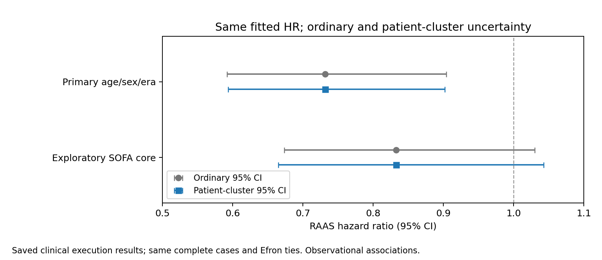

<!-- Generated by scripts/render_short_notes.py; edit its templates rather than this file. -->

# 05a — Patient-cluster sensitivity (SHORT)

[Full notebook](../notebooks/05a_patient_cluster_sensitivity.ipynb)

## Objective

Compare ordinary and patient-cluster inference on the same primary and exploratory core admissions.

## Input

- The source notebook defaults to `DATA_MODE = "synthetic"`; those outputs are artificial demonstrations. `current` explicitly uses the approved, US-dry-run/200-MB-capped loader; patient/admission/stay keys remain in memory. `local` reads a saved, hash-verified aggregate result without another query. Never display admission-level rows.
- Shares the original extended-outcome/detailed-order inputs; published values come from the selected aggregate record.

## Output and downstream use

- Aggregate tables and figures in the notebook; no BigQuery table or main estimate is overwritten.
- The explicit CLI `--output` option saves aggregate JSON and figures under ignored `reports/local_supplements/`. Tracked notebooks retain only the reviewed aggregate outputs bound in `NOTEBOOK_EXECUTION_VALIDATION.json`.
- Selected clinical aggregates are published separately in [the results record](SURVIVAL_SENSITIVITY_RESULTS.json) and [Quarto](https://makotoy56.github.io/mimic-iv-copd-raas-analysis/copd_raas_survival_report.html#supplementary-sensitivity-analyses).

## Key methods and scope

- Retains point estimates, complete cases, age/sex/era specification and Efron ties; core additionally includes SOFA, CHF, CKD and diabetes.
- Sums Efron score residuals across a patient's admissions, including across era strata. Uses HC0 sandwich variance and normal Wald 95% intervals/p-values without a finite-cluster correction.
- Handles tied event/censor times without jitter; synthetic covariance was compared with R survival. No frailty or recurrent-event process model is fitted.
- Core still uses potentially post-start SOFA. This is a binary-RAAS sensitivity, not a new subgroup contrast.

## Results summary

Published clinical results, not the default synthetic notebook output. Source: [selected aggregate record](SURVIVAL_SENSITIVITY_RESULTS.json).

| Model | HR | Ordinary 95% CI | Patient-cluster 95% CI | Cluster p |
| --- | ---: | --- | --- | ---: |
| Primary age/sex/era | 0.732 | 0.592–0.904 | 0.593–0.902 | 0.00346 |
| Exploratory SOFA core | 0.833 | 0.673–1.030 | 0.665–1.042 | 0.11019 |

11,964 admissions represent 9,157 patients; 1,656 patients contributed 4,463 admissions across repeated hospitalizations.

### Figure 1 — Ordinary and patient-cluster inference

**Data source:** Saved clinical execution results; [aggregate record](SURVIVAL_SENSITIVITY_RESULTS.json).

**How to read**

- Gray circles show ordinary admission-level 95% intervals; blue squares show patient-cluster 95% intervals. Colors distinguish inference methods, not exposure groups. Each pair shares one fitted RAAS HR and the same complete cases; its vertical offset is only for readability.
- The dashed HR=1 line represents equal hazards. Patient clustering allows dependence among repeated admissions from one patient when estimating uncertainty; it does not fit a frailty model, remove confounding or change the exposure definition. A cluster interval can be wider or narrower.

**What the results show**

- The primary HR remains 0.732, with patient-cluster CI 0.593–0.902. The exploratory SOFA-core HR remains 0.833, with cluster CI 0.665–1.042, which includes 1. The core result does not establish equal hazards or equivalence.

**Interpretation limits**

- Compare uncertainty methods within a model. The two covariate specifications are not a formal between-model test or evidence of causal treatment benefit; the SOFA timing limitation remains.

## Related analyses

[Full published supplementary section](https://makotoy56.github.io/mimic-iv-copd-raas-analysis/copd_raas_survival_report.html#supplementary-sensitivity-analyses) and [methods/validation guide](SURVIVAL_SENSITIVITY_SUPPLEMENTS.md).

## Next step

Next: [05b — Competing hospital endpoints](05b_competing_risks_SHORT.md).
