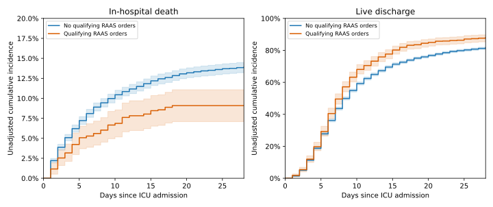

<!-- Generated by scripts/render_short_notes.py; edit its templates rather than this file. -->

# 05b — Death and discharge as competing events (SHORT)

[Full notebook](../notebooks/05b_competing_risks.ipynb)

## Objective

Report unadjusted cumulative incidence of death and live discharge, alongside separate adjusted cause-specific Cox associations.

## Input

- The source notebook defaults to `DATA_MODE = "synthetic"`; those outputs are artificial demonstrations. `current` explicitly uses the approved, US-dry-run/200-MB-capped loader; patient/admission/stay keys remain in memory. `local` reads a saved, hash-verified aggregate result without another query. Never display admission-level rows.
- Same continuous ICU-entry follow-up; death is event 1 and live discharge event 2.

## Output and downstream use

- Aggregate tables and figures in the notebook; no BigQuery table or main estimate is overwritten.
- The explicit CLI `--output` option saves aggregate JSON and figures under ignored `reports/local_supplements/`. The original clinical execution is recorded in `NOTEBOOK_EXECUTION_VALIDATION.json`; current caption/summary refreshes from those saved aggregates are bound separately in `NOTEBOOK_PRESENTATION_VALIDATION.json`.
- Selected clinical aggregates are published separately in [the results record](SURVIVAL_SENSITIVITY_RESULTS.json) and [Quarto](https://makotoy56.github.io/mimic-iv-copd-raas-analysis/copd_raas_survival_report.html#supplementary-sensitivity-analyses).

## Key methods and scope

- Uses two-cause Aalen-Johansen probabilities on a fixed daily grid through day 28. Tied endpoints use a shared pre-event risk set without jitter.
- Clinical intervals use 1,000 patient-cluster bootstrap draws, fixed patient ordering and seed 20261118; all admissions/exposure groups of each sampled patient travel together.
- Intervals are pointwise percentile intervals, not simultaneous bands. Original discharge-time proxies for unknown death times are retained.
- Age/sex/era cause-specific Cox models for death and discharge use patient-cluster inference. These adjusted rates and unadjusted CIFs answer different questions; no Fine–Gray model is fitted.

## Results summary

### Table 1 — Saved death and live-discharge cumulative incidence

| Qualifying RAAS orders | Day | Death CIF %, 95% CI | Live-discharge CIF %, 95% CI |
| --- | ---: | --- | --- |
| No | 7 | 8.90 (8.41–9.43) | 43.62 (42.66–44.59) |
| No | 14 | 11.84 (11.26–12.42) | 69.55 (68.68–70.48) |
| No | 28 | 13.90 (13.28–14.54) | 81.68 (80.95–82.40) |
| Yes | 7 | 5.60 (4.15–7.15) | 49.58 (46.34–52.83) |
| Yes | 14 | 8.03 (6.21–9.93) | 77.70 (74.73–80.39) |
| Yes | 28 | 9.09 (7.09–11.08) | 87.95 (85.76–90.06) |

**Summary:** At day 28, unadjusted death CIF is 9.09% with qualifying RAAS orders and 13.90% without; live-discharge CIF is 87.95% and 81.68%, respectively. Intervals use 1,000 patient-cluster bootstrap draws and are pointwise, not simultaneous. These unadjusted associations do not establish treatment effects.

Day-28 death-CIF difference, RAAS minus no RAAS: -4.81 percentage points (95% CI -6.82 to -2.66).

### Figure 1 — Death and live-discharge cumulative incidence

**How to read**

- The horizontal axis is days since ICU entry. The left panel is the unadjusted cumulative incidence of hospital death and the right panel is live discharge, treating the other endpoint as competing. Blue denotes qualifying RAAS orders; orange denotes no qualifying orders. Each curve's height is an absolute cumulative probability, not a hazard ratio.
- Shading shows pointwise patient-bootstrap 95% intervals on the saved daily grid. These are not simultaneous confidence bands. The published death panel spans 0–20%, while the discharge panel spans 0–100%; compare the printed percentages rather than line heights between panels.

**What the results show**

- At day 28, death CIF is 9.09% with qualifying orders and 13.90% without. Live-discharge CIF is 87.95% and 81.68%, respectively. The saved estimates indicate different observed endpoint patterns between the groups.

**Interpretation limits**

- These curves are unadjusted associations and do not establish a treatment effect. They answer a different question from the adjusted cause-specific HRs and from Kaplan–Meier curves that censor discharge. No Fine–Gray model is shown.
### Table 2 — Saved adjusted cause-specific Cox associations

| Endpoint | HR | Patient-cluster 95% CI | p |
| --- | ---: | --- | ---: |
| In-hospital death | 0.732 | 0.593–0.902 | 0.00346 |
| Live discharge | 1.168 | 1.087–1.254 | 0.00002 |

**Summary:** death: HR 0.732 (95% CI 0.593–0.902); p=0.003455. 11,964 admissions, 1,692 deaths. The interval lies below 1. discharge: HR 1.168 (95% CI 1.087–1.254); p=2.088e-05. 11,964 admissions, 10,272 live discharges. The interval lies above 1.

The age/sex/era cause-specific models describe rates while alive and hospitalized. Their adjusted HRs and the unadjusted CIFs answer different questions. No Fine–Gray model or causal treatment effect is claimed.

## Related analyses

The [Quarto section](https://makotoy56.github.io/mimic-iv-copd-raas-analysis/copd_raas_survival_report.html#supplementary-sensitivity-analyses) includes the curves and adjusted cause-specific results. See [the selected aggregate record](SURVIVAL_SENSITIVITY_RESULTS.json).

## Next step

Next: [05c — Separate 24-hour landmark](05c_time_aligned_severity_SHORT.md).
