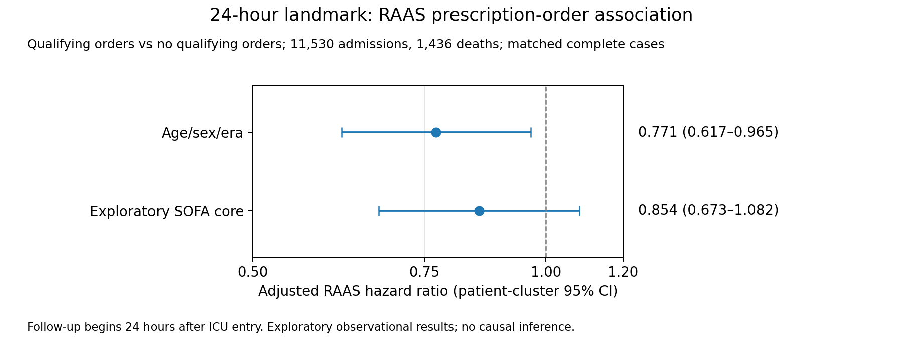

<!-- Generated by scripts/render_short_notes.py; edit its templates rather than this file. -->

# 05c — Separate 24-hour severity landmark (SHORT)

[Full notebook](../notebooks/05c_time_aligned_severity.ipynb)

## Objective

Explore first-day severity among admissions alive and still hospitalized beyond 24 hours after ICU entry; this changes the population and estimand.

## Input

- The source notebook defaults to `DATA_MODE = "current"`, using the existing read-only, US-dry-run/200-MB-capped loader. Missing configuration, credentials or access stops execution with guidance; no synthetic fallback is used. `synthetic` must be selected explicitly for artificial software checks; `local` explicitly reads a saved, hash-verified aggregate bundle without another query. The selected mode is announced before loading; patient/admission/stay keys remain in memory. Never display admission-level rows.
- Original prescription-order grouping and first-day SOFA/core covariates.

## Output and downstream use

- Aggregate tables and figures in the notebook; no BigQuery table or main estimate is overwritten.
- The explicit CLI `--output` option saves aggregate JSON and figures under ignored `reports/local_supplements/`. The original clinical execution is recorded in `NOTEBOOK_EXECUTION_VALIDATION.json`; the historical caption/summary refresh is bound in `NOTEBOOK_PRESENTATION_VALIDATION.json`. The later real-data current-default execution of 05a–05c is bound separately in [SUPPLEMENT_NOTEBOOK_EXECUTION_VALIDATION.json](SUPPLEMENT_NOTEBOOK_EXECUTION_VALIDATION.json).
- Selected clinical aggregates are published separately in [the results record](SURVIVAL_SENSITIVITY_RESULTS.json) and [Quarto](https://makotoy56.github.io/mimic-iv-copd-raas-analysis/copd_raas_survival_report.html#supplementary-sensitivity-analyses).
- The published clinical tables and forest plot are visible in the notebook and this SHORT guide without execution; they are regenerated from the verified public aggregate record.

## Key methods and scope

- Excludes endpoints at or before 24 hours and remaining deaths with unknown death times, then subtracts one day from eligible follow-up.
- Keeps the original exposure window at or before ICU entry; both landmark models use identical core-complete admissions, era strata and patient-cluster Efron inference.
- Relies on the published first-day-SOFA window. Individual component times and deployed windows were not independently reconstructed.
- SOFA is post-exposure; mediation/selection bias and comorbidity-code timing remain concerns. This does not reconstruct pre-ICU severity or establish causality.

## Results summary

The tables and figures in this section display saved clinical execution results from [the public aggregate record](SURVIVAL_SENSITIVITY_RESULTS.json). They do not represent a new clinical rerun. The separately labeled execution section describes how to reproduce outputs. Any synthetic execution is explicitly labeled and is not a clinical MIMIC result.
### Table 1 — Saved sequential 24-hour landmark eligibility

| Eligibility step | Admissions |
| --- | ---: |
| Original ICU-entry cohort | 11,964 |
| Excluded: death at or before 24 hours | 254 |
| Excluded: live discharge at or before 24 hours | 178 |
| Excluded: remaining death with unknown death time | 2 |
| Eligible: alive and hospitalized beyond 24 hours | 11,530 |
| Excluded: missing core covariates among eligible admissions | 0 |
| Analyzed in each matched landmark model | 11,530 |

**Summary:** Of 11,964 original admissions, 254 deaths and 178 live discharges occurred at or before 24 hours; 2 remaining deaths with unknown times were excluded. 11,530 admissions remained eligible, with 0 subsequently excluded for missing core covariates. Both matched models use 11,530 admissions (8,854 patients).
### Table 2 — Saved matched landmark Cox results

| Model | Admissions | Deaths | Adjusted HR | Patient-cluster 95% CI | p |
| --- | ---: | ---: | ---: | --- | ---: |
| Age/sex/era | 11,530 | 1,436 | 0.771 | 0.617–0.965 | 0.02313 |
| Exploratory SOFA core | 11,530 | 1,436 | 0.854 | 0.673–1.082 | 0.19133 |

**Summary:** Age/sex/era: HR 0.771 (95% CI 0.617–0.965); p=0.02313. 11,530 admissions, 1,436 deaths. The interval lies below 1. Exploratory SOFA core: HR 0.854 (95% CI 0.673–1.082); p=0.1913. 11,530 admissions, 1,436 deaths. The interval includes 1; this does not establish equivalence or absence of an association.
### Figure 1 — 24-hour landmark Cox models

**How to read**

- Each blue dot is the adjusted hazard ratio for qualifying pre-ICU RAAS orders versus no qualifying orders. Each horizontal line is its patient-cluster 95% confidence interval; it is not a distribution of patient outcomes.
- The dashed line at HR=1 represents equal hazards under the fitted model. Points to its left indicate a lower estimated death hazard, and points to its right indicate a higher estimated hazard. This is a hazard comparison, not an absolute mortality probability. The horizontal axis uses a logarithmic scale.
- The first row adjusts for age and sex with era strata. The second additionally includes first-day SOFA, CHF, CKD and diabetes. Both use the same 11,530 admissions alive and hospitalized beyond 24 hours, with follow-up beginning at that landmark.

**What the results show**

- Age/sex/era: HR 0.771 (95% CI 0.617–0.965). The interval lies below 1.
- Exploratory SOFA core: HR 0.854 (95% CI 0.673–1.082). The second point estimate is closer to 1. The interval includes 1; this does not establish equivalence or absence of an association.

**Interpretation limits**

The two rows are different adjustment specifications, not separate treatment groups or a formal test between model estimates. Differences in whether intervals include 1 do not establish a statistically significant difference between the estimates. Their change cannot be attributed solely to controlling baseline severity: first-day SOFA is post-exposure, and individual component times remain independently unverified. The landmark also changes the population and time origin relative to the original ICU-entry analysis. Neither row establishes a causal treatment effect.

## Related analyses

[Methods and remaining limitations](SURVIVAL_SENSITIVITY_SUPPLEMENTS.md#05c-a-separate-24-hour-landmark).

## Next step

Read [the published supplementary section](https://makotoy56.github.io/mimic-iv-copd-raas-analysis/copd_raas_survival_report.html#supplementary-sensitivity-analyses).
